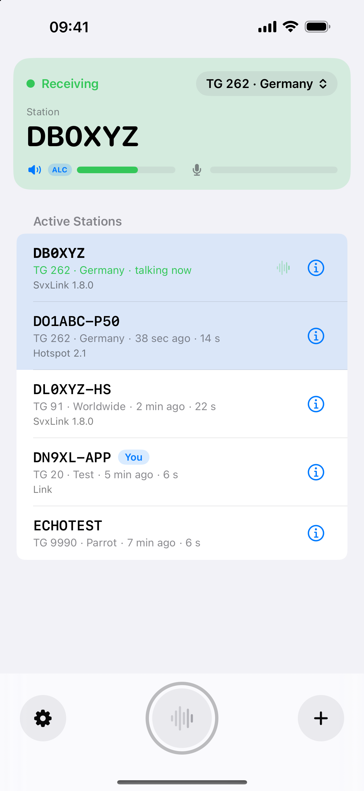
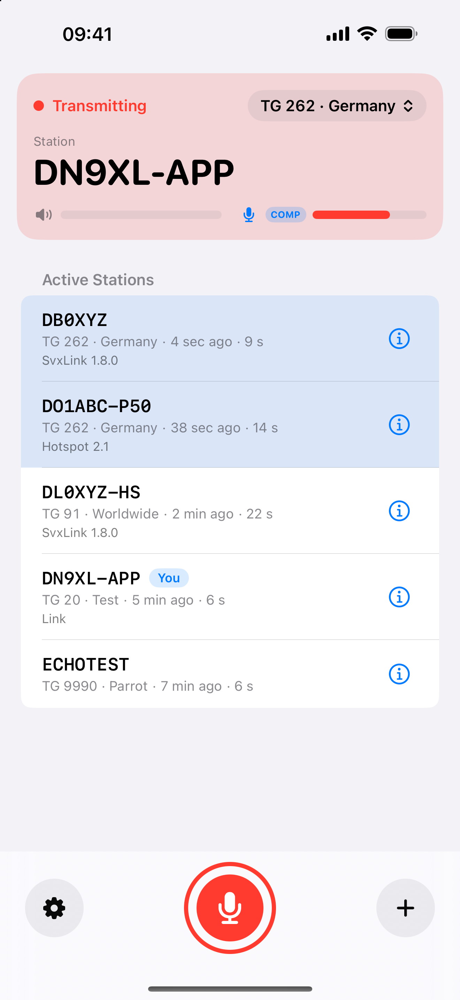
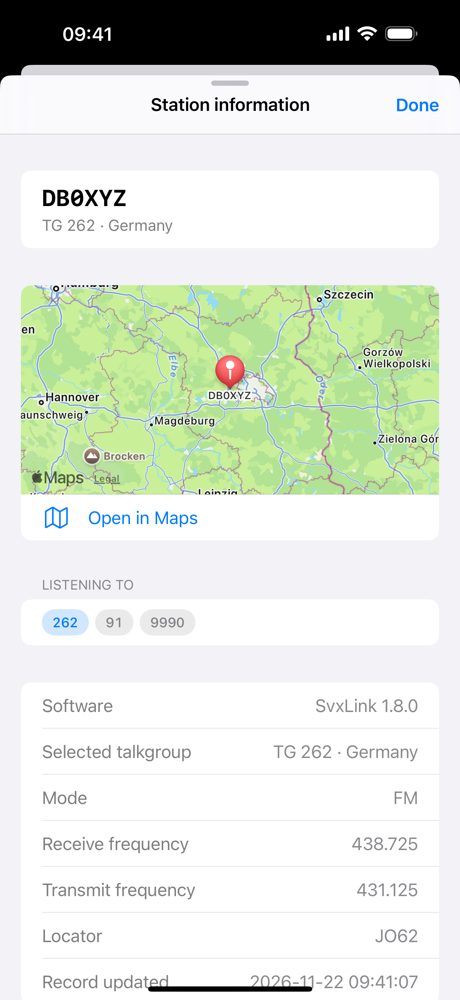
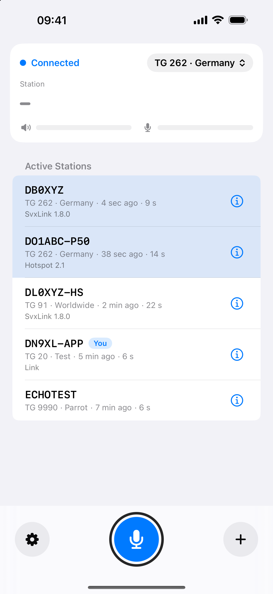
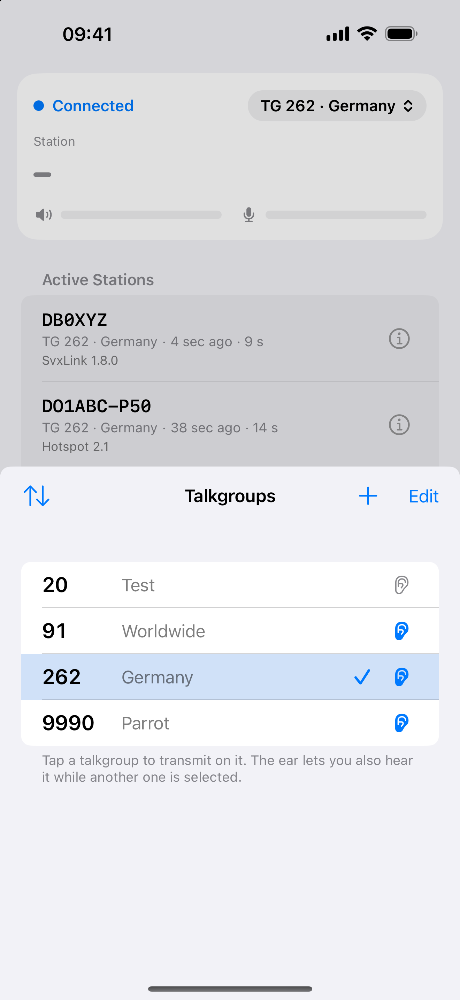
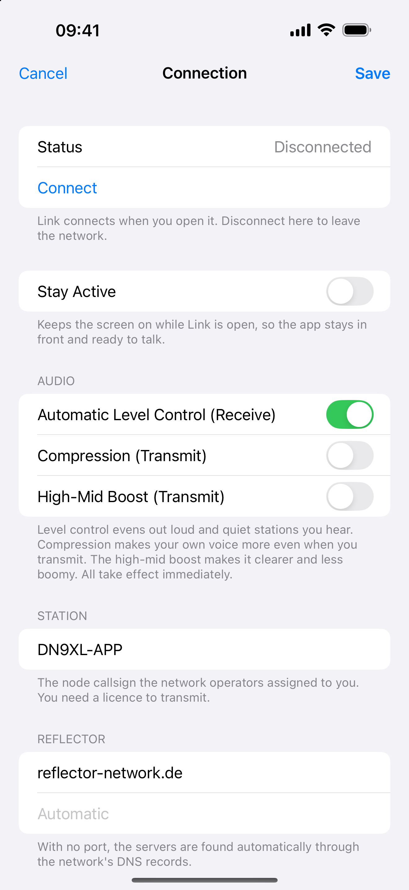

# Link

**Push-to-talk for ham radio, for iPhone.**

Link joins amateur radio networks that run SvxReflector, such as FM-Funknetz, as a node on your iPhone. You hear the talkgroups you choose, talk with one button, and see which stations are active.

<table>
  <tr>
    <td align="center"><picture><source media="(prefers-color-scheme: dark)" srcset="docs/screenshots/dark/1-receiving.png"></picture></td>
    <td align="center"><picture><source media="(prefers-color-scheme: dark)" srcset="docs/screenshots/dark/2-transmitting.png"></picture></td>
    <td align="center"><picture><source media="(prefers-color-scheme: dark)" srcset="docs/screenshots/dark/3-station-info.png"></picture></td>
  </tr>
  <tr>
    <td align="center"><picture><source media="(prefers-color-scheme: dark)" srcset="docs/screenshots/dark/4-main.png"></picture></td>
    <td align="center"><picture><source media="(prefers-color-scheme: dark)" srcset="docs/screenshots/dark/5-talkgroups.png"></picture></td>
    <td align="center"><picture><source media="(prefers-color-scheme: dark)" srcset="docs/screenshots/dark/6-settings.png"></picture></td>
  </tr>
</table>

Link needs a node callsign and an authentication key, which the operators of your network issue to licensed radio amateurs. Without them the app starts but cannot connect. Transmitting requires an amateur radio licence and must follow the rules that apply to you.

## Talk and listen

- Hold the big button to talk, release to listen, with a haptic tick on press.
- The header shows the connection state, the current station and its talkgroup, errors with the action to fix them, and live level meters for what you hear and what you send.
- Choose the talkgroup to talk on from your own list, and listen to more talkgroups at the same time.

## See who is active

- A live list of the stations that talked recently, anywhere on the network, with the one talking right now on top.
- Tap a station to switch to its talkgroup. Tap its info icon to see what the network publishes about it, such as software, mode, frequencies and locator, with a small map when the station publishes a locator. The talkgroups it listens to are buttons that switch your talkgroup. Press and hold to copy the callsign or look it up on QRZ.com.

## Your talkgroups

- Add talkgroups with a number and your own name; rename, sort, reorder and delete them.

## Better audio (optional)

- Automatic level control evens out loud and quiet stations you hear.
- Compression makes your own voice more even when you transmit.
- A voice filter removes rumble below 250 Hz and makes your voice clearer and less boomy.
- Each is a switch in Settings and shows a small badge next to the level meters while on.

## Made for the air

- Connects when you open it and reconnects by itself after a network change.
- Stay Active keeps the screen on while Link is open.
- Light and dark appearance, VoiceOver and Dynamic Type.

## Secure

- The reflector connection is encrypted, and so is the audio. The server's certificate authority is remembered on first use and the app refuses to continue if it ever changes.
- The authentication key is stored in the iOS Keychain.
- No account, no ads, no tracking, nothing sent to the developer.

## Privacy and support

- [Privacy policy](https://loopmasta.github.io/link/privacy/)
- [Support](https://loopmasta.github.io/link/support/)
